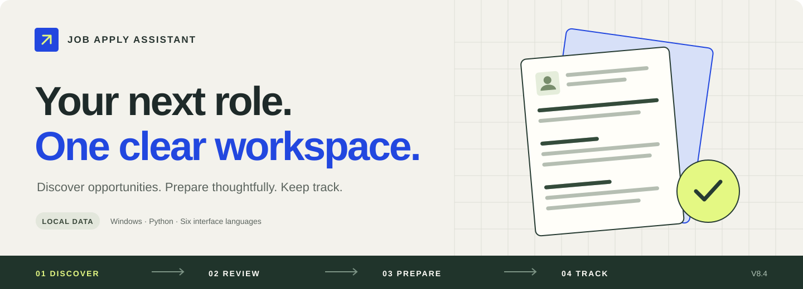
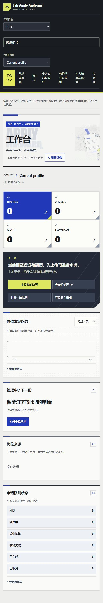

<div align="center">

# Job Apply Assistant

**把寻找岗位、准备申请与跟进结果，放进一个清晰的本地工作台。**

[English](README.md) · 简体中文

[快速开始](#快速开始) · [主要功能](#让求职过程更有条理) · [使用指南](USER_GUIDE.md) · [文档导航](docs/README.md)

</div>



<p align="center">
  
  
  
  
</p>

在自己的电脑上管理岗位、简历、申请材料和投递记录。第一次使用可以跟着指引手动投递；需要时，再开启浏览器辅助。个人档案与求职历史保存在本机。

## 让求职过程更有条理

| 寻找合适的机会 | 带着上下文准备材料 |
| --- | --- |
| 搜索支持的招聘网站、公开 ATS 招聘页和自定义来源；按不同目标建立搜索计划，合并重复岗位。 | 管理多份简历、复核岗位匹配情况，并可通过已登录的 ChatGPT 浏览器会话生成针对岗位的法语求职信。 |
| **随时知道下一步** | **跟进真实结果** |
| 工作台与准备队列显示当前步骤、已就绪材料和需要你接管的地方。 | 记录收藏、已确认投递、面试和招聘方反馈；将复核结果导出为独立 HTML 或 Excel。 |
| **分开管理不同候选人** | **使用熟悉的语言** |
| 每个档案分别保存个人资料、文件、网站账号、待处理事项和历史记录。 | 支持中文、法语、英语、德语、西班牙语和葡萄牙语；保留岗位原标题供核验。 |

### 从发现岗位到跟进结果

1. **准备个人资料。** 上传简历，填写目标岗位、地点和可工作时间。
2. **寻找并核验岗位。** 阅读原始招聘信息；经过 AI 复核的推荐仍由你亲自确认。
3. **准备一份申请。** 将选中的岗位加入队列，检查材料，按提示补充缺项或接管页面。
4. **提交并跟进。** 默认由你在招聘网站提交，成功后回到平台记录，并持续跟进反馈。

<details>
<summary><strong>查看真实工作台</strong> · 新建档案的窄屏布局</summary>

截图来自实际运行的应用。当前档案为空，计数为零；没有为展示添加虚构投递或私人简历。



</details>

## 快速开始

**运行环境：Windows、Python 3.11 及以上、Chrome 或 Edge。**

克隆仓库并运行 Windows 安装入口：

```powershell
git clone https://github.com/bowen-rgb/job-apply-assistant.git
cd job-apply-assistant
.\run_windows.bat
```

安装程序会创建独立 Python 环境、安装依赖和浏览器组件、准备本地档案，并打开 **<http://127.0.0.1:8765>**。

之后双击 **`start.bat`** 即可启动。在侧边栏选择 **从这里开始**，跟着指引完成第一份申请；也可以先进入 **个人资料与偏好** 填写信息并上传简历。

| 你想做什么 | 需要准备什么 |
| --- | --- |
| 手动投递并记录进展 | 个人资料、简历和招聘网站；无需连接 ChatGPT。 |
| 复核匹配情况、生成求职信 | 在启动程序打开的专用浏览器里登录 ChatGPT；无需 OpenAI API 密钥。 |
| 辅助准备支持的申请表单 | 已启用的简历、完整资料和专用浏览器连接；部分网站仍需手动操作。 |

**遇到问题？** 先运行 `doctor.bat`，再查看[使用指南](USER_GUIDE.md)、[档案与账号说明](ACCOUNT_SETUP.md)或[安装问题说明](FIX_V8_2.md)。

<details>
<summary>手动配置 Python 环境</summary>

建议首次使用 Windows 安装入口。需要手动配置时，请将以下依赖分步安装：

```powershell
python -m venv .venv
.\.venv\Scripts\python.exe -m pip install -r requirements.txt
.\.venv\Scripts\python.exe -m pip install -r requirements-jobspy.txt
.\.venv\Scripts\python.exe -m pip install -r requirements-scrapling.txt
.\.venv\Scripts\python.exe -m playwright install chromium
if (-not (Test-Path profile.json)) { Copy-Item profile.example.json profile.json }
.\.venv\Scripts\python.exe -m uvicorn app.main:app --host 127.0.0.1 --port 8765
```

需要浏览器辅助时运行 `start_chrome_debug.bat`，默认连接地址为 `http://127.0.0.1:9222`。它使用独立浏览器档案，与日常浏览器分开。

</details>

## 数据与操作由你掌握

- **本地保存。** 个人资料、简历、浏览器会话、账号凭据和岗位记录已被 Git 忽略；服务只接受本机连接。网站密码使用当前 Windows 用户的加密能力保存。
- **按需使用外部服务。** ChatGPT 功能会将所选任务需要的岗位、档案或简历文本发送到已登录的 ChatGPT 会话；按需翻译标题时可能将公开岗位标题发送给 MyMemory。本地保存不代表全部功能离线运行。
- **默认手动提交。** 自动启动队列与自动发送申请分别设置，均需主动开启。自动发送只适用于能够识别且填写完整的支持表单；AI 已复核岗位仍需本人确认。
- **需要时明确接管。** 缺项、验证码、MFA、同意声明和发送结果不明确时会暂停。Gmail 提供连接配置；自动读取验证码和找回密码尚未实现。

招聘网站的可访问性与搜索结果取决于对应来源。匹配分数和 AI 建议不等于岗位仍在招聘；提交前请核验原始岗位与准备好的表单。

## 文档导航

| 开始使用 | 进一步了解 |
| --- | --- |
| [使用指南 · 法语 / 中文](USER_GUIDE.md) | [架构与模块边界](ARCHITECTURE.md) |
| [个人档案、网站账号与 Gmail](ACCOUNT_SETUP.md) | [工作台设计与指标定义](DASHBOARD_DESIGN.md) |
| [研究与申请工作流](RESEARCH_WORKFLOW.md) | [界面设计说明](DESIGN.md) |
| [V8.4 变更](CHANGELOG_V8_4.md) | [历次功能与发布说明归档](docs/archive/README-before-refresh.md) |

## 开发与验证

应用采用 **FastAPI、SQLite 和原生 JavaScript 界面**，集成 Playwright、Scrapling 与可选的 JobSpy，无需单独执行 npm 构建。

```powershell
.\.venv\Scripts\python.exe -m pip install -r requirements-dev.txt
.\.venv\Scripts\python.exe -m playwright install chromium
.\.venv\Scripts\python.exe -m unittest discover -s tests -v
```

发现问题或有功能建议，可以[提交 Issue](https://github.com/bowen-rgb/job-apply-assistant/issues)，附上复现步骤和诊断信息；发布前请移除私人资料与凭据。

---

[开源项目参考](OPEN_SOURCE_REFERENCES.md) · [第三方声明](THIRD_PARTY_NOTICES.md) · [仓库首页设计参考](docs/README_DESIGN.md)
